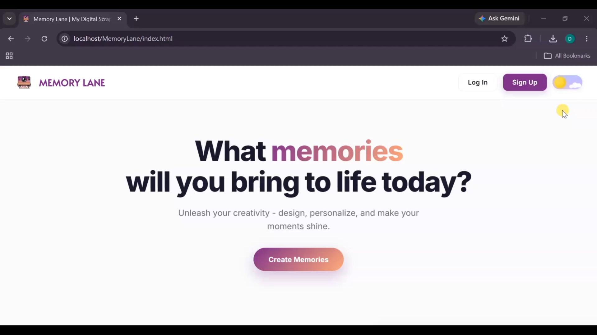
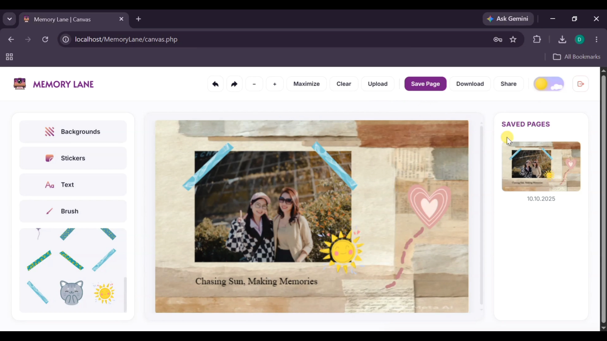

# MemoryLane | Interactive Digital Scrapbook & Canvas Web Application

[](https://www.php.net/)
[](https://www.mysql.com/)
[](https://developer.mozilla.org/en-US/docs/Web/API/Canvas_API)
[](https://developer.mozilla.org/en-US/docs/Web/HTML)
[](https://developer.mozilla.org/en-US/docs/Web/CSS)

MemoryLane is a digital scrapbook and journaling web app I built to learn web development with database persistence. Users can draw on an interactive canvas, add stickers and personal photos, pick background textures, and save their pages to a MySQL database tied to their account. I built it end to end — frontend canvas logic, PHP backend, and the relational database schema.

---

## Core Features

- **Interactive Canvas Editor** — HTML5 Canvas drawing area with freehand sketching, adjustable brush sizes, and color palettes.
- **Custom Image Uploads & Stickers** — Upload personal photos and decorate pages with stickers, pins, and background textures.
- **User Authentication & Session Security** — Multi-user login and registration with BCrypt password hashing (`password_hash` / `password_verify`).
- **Canvas Persistence** — Save canvas layouts to the MySQL database, linked to the authenticated user.
- **Saved Memory Gallery** — Load, view, and continue editing past scrapbook pages tied to your account.
- **Confetti Animation** — Plays celebratory confetti (`canvas-confetti`) when you save a new page.

---

## Screenshots

### Landing Page


### Canvas Workspace


---

## Tech Stack

- **Backend:** PHP (native sessions, prepared MySQLi statements)
- **Database:** MySQL / MariaDB (relational user + canvas page schema)
- **Frontend:** HTML5 Canvas API, vanilla JavaScript (ES6+), CSS3 Flexbox/Grid
- **Libraries:** Google Fonts (Alata, Inter), Canvas Confetti, Ionicons

---

## Database Architecture

The schema in `schema.sql` defines two relational tables:

- **`users`** — registered accounts with hashed credentials (`id`, `username`, `email`, `password`, `created_at`).
- **`canvas_pages`** — user-created scrapbook pages and snapshot references, with cascade delete (`id`, `user_id`, `title`, `image_path`, `created_at`).

---

## What I Learned / Challenges

**Saving canvas artwork to MySQL**
The hardest part was deciding *how* to store the drawing. I converted the canvas to an image on the client (`canvas.toDataURL()`), sent it to `save_canvas.php`, and stored the result so it could be reloaded later via `load_canvas.php`. Getting the data through a POST request without corrupting it took careful handling of base64 data and file writes.

**User authentication from scratch**
I built `signup.php` and `login.php` without a framework, which meant handling password hashing myself with `password_hash()` and `password_verify()`, plus managing PHP sessions so each user only sees their own pages. This taught me why you never store plain-text passwords and how session state actually works.

**Preventing SQL injection**
Early on I was building queries with string concatenation. Switching to prepared MySQLi statements in `db.php` and the save/load scripts made me understand the difference between "it works" and "it's safe."

**File paths and uploads in XAMPP**
Getting uploaded images and stickers to resolve correctly between the browser, PHP, and the `uploads/` folder was a constant source of bugs — especially relative vs. absolute paths. Debugging this taught me a lot about how a local web server actually serves files.

**Structuring a project across multiple modules**
Splitting logic into `canvas.js` (drawing + stickers), `stickers.js` (sticker definitions), `save_canvas.php` / `load_canvas.php` (persistence), and `db.php` (connection) forced me to think about separation of concerns instead of putting everything in one file.

---

## Future Improvements

- Undo/redo on the canvas (currently no way to step back a stroke)
- Move uploads to cloud storage (S3/Cloudinary) instead of the local `uploads/` folder
- Store drawings as vector stroke data instead of a flat image, so saved pages stay editable
- Layer support for stickers and drawings (z-ordering)
- Mobile/touch support for drawing on phones and tablets
- Pagination or search in the saved gallery as the number of pages grows
- CSRF protection on the save and login forms
- Environment-based config for `db.php` instead of hardcoded credentials

---

## Getting Started

### Prerequisites

- [XAMPP](https://www.apachefriends.org/) (Apache + MySQL/MariaDB) or any local LAMP/WAMP/MAMP stack with PHP 7.4+ or 8.x
- Modern web browser (Chrome, Edge, Firefox, Safari)

---

### Step 1: Place the Project in `htdocs`

Put this folder in your XAMPP web root:
```text
C:\xampp\htdocs\MemoryLane
```

Or clone directly into `htdocs`:
```bash
cd C:\xampp\htdocs
git clone https://github.com/AsfaThahani/MemoryLane.git
```

---

### Step 2: Database Setup

1. Start **Apache** and **MySQL** from your XAMPP Control Panel.
2. Open phpMyAdmin in your browser at `http://localhost/phpmyadmin`.
3. Click the **Import** tab.
4. Select `schema.sql` from the project root and click **Import** (or create a database named `memorylane` and run the script).

`schema.sql` provisions:
```sql
CREATE DATABASE IF NOT EXISTS memorylane;
USE memorylane;
-- Creates `users` and `canvas_pages` tables
```

---

### Step 3: Database Connection Config

If your local MySQL credentials differ from XAMPP defaults, update `db.php`:

```php
$server_name   = "127.0.0.1";
$username      = "root";
$password      = "";          // Your MySQL root password (default is empty in XAMPP)
$database_name = "memorylane";
$port          = 3306;        // Standard MySQL port (or 3307 if configured)
```

---

### Step 4: Run the Application

Open your browser and navigate to:
```text
http://localhost/MemoryLane
```

Sign up for a new account, log in, and start creating your memory canvas!
